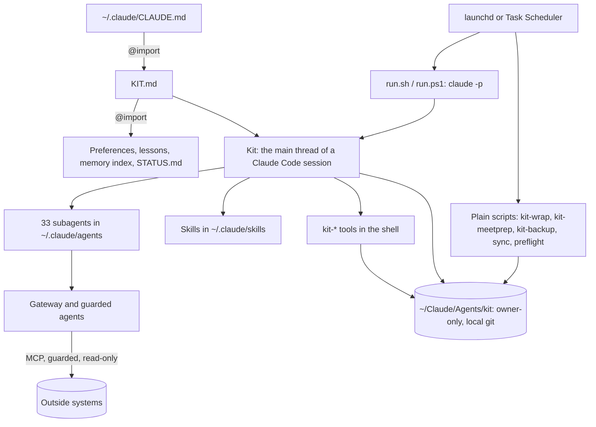
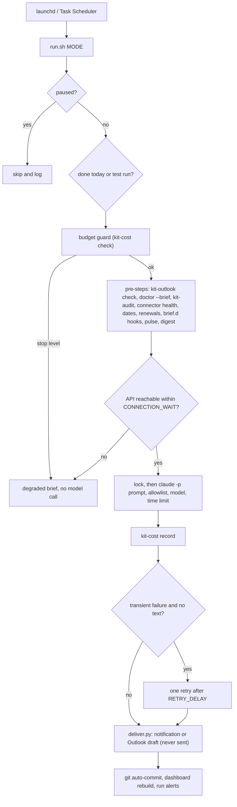
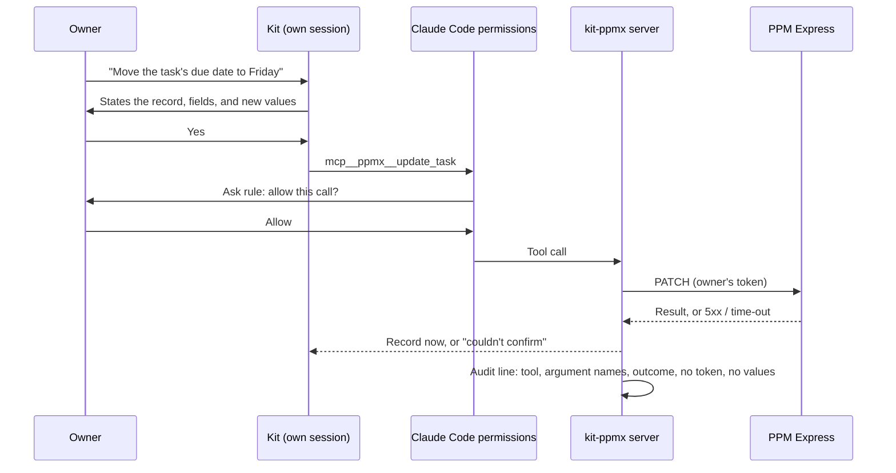
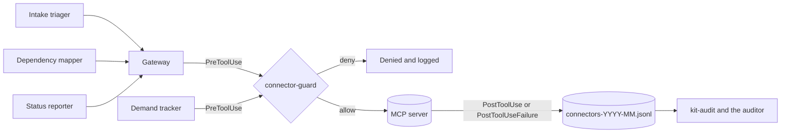
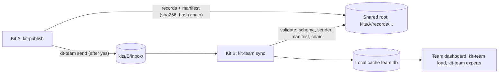

# Kit design guide

How Kit is built, how it's controlled, and how to extend it. This guide is for maintainers, security
reviewers, and adopters who want to know what Kit does under the hood. It draws on the code in this
repository; [DESIGN.md](../DESIGN.md) is the shorter reference that sits beside the code, and
[CONNECTIVITY.md](CONNECTIVITY.md) covers outside connections in detail.

| | |
|---|---|
| Describes | Kit 1.6.2 |
| Date | 03-Nov-2026 |
| Audience | Maintainers, security reviewers, technical adopters |
| Licence | All rights reserved; see [LICENSE](../LICENSE) |

## 1. Summary

Kit is an AI personal assistant that runs inside Claude Code, for one owner, on that owner's computer. It
is mostly configuration and plain files: a rules file (`KIT.md`) that Claude Code loads in every session,
a memory of short Markdown notes, 33 subagent definitions, and a set of standard-library Python tools.
Scheduled runs call Claude Code headless for the morning brief, weekly review, and work list; most other
routine jobs are plain scripts with no model call.

The design rests on four ideas:

1. **People decide.** Kit drafts, checks, and recommends. Anything outward-facing waits for the owner's
   yes, and delegating to an agent never widens what's allowed.
2. **Least privilege, enforced where possible.** Each agent gets only the tools its job needs. Outside
   systems are read through a guarded gateway that denies writes and logs every call. Where Kit can't
   enforce a rule in code, it says so and reports the gap.
3. **Local first.** Kit's memory lives in one owner-only folder, under a private git history that never
   gets a remote. Nothing leaves unless the owner shares it, and sharing is limited by policy.
4. **Plain and testable.** Python's standard library for the core, a test suite for every tool, and CI
   on Linux and Windows.

## 2. Architecture



### 2.1 Layers in the repository

| Layer | Folder | Holds |
|---|---|---|
| Brain | `kit/` | `KIT.md` (who Kit is and its rules), starter `QUEUE.md` and `STATUS.md`, `agents/`, `memory/` (index, glossary, setup files in `memory/context/`), `lessons/`, `preferences/`, `templates/` (45 templates), `skills/`, `models.json`. No platform code. |
| Shared | `shared/` | Cross-platform Python: the installer logic (`kit_setup.py`), health check (`doctor.py`), dashboards, delivery (`deliver.py`), transports, the to-do sync core, model routing, the PPM Express server (`ppmx/`), record schemas (`records/`), SQL scripts (`sql/`), scheduled-run prompts and `config.example` (`morning/`), and 73 tools in `shared/bin/`. |
| Platform | `platform/mac/`, `platform/windows/` | Installers and uninstallers, the scheduled-run runner (`run.sh`, `run.ps1`), job templates or task registration, preflight, and the native adapters: mail, calendar, reminders, and on macOS the library and texting helpers. |
| Tests | `tests/` | Suites per tool (`test_*.sh`, `test_*.py`) and agent eval cases (`tests/evals/`). |

The installer copies the whole package to `~/Claude/Agents/kit/.install/`, so the download can be
deleted, and records what it changed in `.install/manifest.json` so the uninstaller removes exactly that.

### 2.2 The brain: KIT.md

`KIT.md` is Kit's identity and rule book: its job, how it works with the owner, when to ask first, how to
keep work and personal apart, and what it keeps. It ends with imports that load in every session:

- `preferences/INDEX.md`: how the owner likes to work (changed only with the owner's agreement).
- `lessons/INDEX.md`: corrections the owner approved, one file each, rule first, then why and how.
- `memory/INDEX.md`: one line per memory file, so Kit knows what to open.
- `STATUS.md`: one page of what's in progress, blocked, and next.

Everything else loads on demand. This keeps every session's context small while giving Kit continuity.

### 2.3 Memory and records

| Store | Location | Rules |
|---|---|---|
| Queue | `QUEUE.md` | Sections for a sprint, the owner, Kit, waiting on others, someday, and done. Items carry added, updated, and due dates. Only the owner checks off the owner's items. Work items carry a `[work]` tag. |
| Status | `STATUS.md` | One page; loads every session. |
| Briefs | `briefs/` | Morning briefs, weekly reviews, work lists, short texts, health and audit snapshots, alerts, prep packs, pending proposals. |
| Memory | `memory/` | One short file per fact in `people/`, `projects/`, `context/`, plus a glossary. Never secrets; never copies of confidential documents. |
| Personal | `memory/personal/` | Same layout, its own index, loaded only when a topic needs it; blocked in protected work folders. |
| Decisions | `memory/decisions/` | One note per decision: what, options, why (never invented), when to revisit. |
| Library | `library/` and the library root in `library.md` | Collections config (`collections.json`); the work library where agents file drafts by project. |
| History | `.git` | A private local repo; scheduled runs commit daily. Never given a remote. |
| Install state | `.install/` | Package copy, `config`, logs, cost ledger, caches (team, library index), backups of Claude Code settings. |

Claude Code's own auto memory still runs for notes that matter inside one project. Anything that applies
across the owner's work goes in Kit's memory instead, and a fact is never kept in both.

### 2.4 The agent model

Each agent is a Markdown file in `kit/agents/` with YAML frontmatter and a body.

```yaml
---
name: gateway
description: When to use the agent (Claude Code routes on this text)
disallowedTools: Write, Edit, NotebookEdit, Bash, WebSearch, WebFetch, Agent, SendMessage, Skill
model: inherit            # written by kit-models apply from models.json
hooks:                    # only on agents that reach outside systems
  PreToolUse: [...]       # kit-hook connector-guard pre <agent>
---
```

The body follows one pattern: you're not Kit; read your setup file first; your sources; what you do;
what you save; your rules; what you send back to Kit.

| Part | Design |
|---|---|
| Tools | Either a `tools:` allowlist (onboarding guide, researcher, red team, threat modeler, curator, auditor, letters desk) or a `disallowedTools:` list. Most agents can't use web tools or start other agents. |
| Setup files | Each agent reads `memory/context/<name>.md` before every job. Unset fields say "not set", and the agent reports what's missing rather than guessing. `doctor.py --readiness` counts agents with no known limit, with limits, or blocked, by cause. |
| Routing | `memory/context/agents.md` is the roster: what each agent does, how to brief it, its routine, its setup. Work goes through Kit except for four direct pairs; agents outside a pair can't start or message other agents. |
| Requests | An agent that needs another's help ends its report with a Requests section; Kit routes each request and briefs the requester again with the answers. |
| Models | `model: inherit` in the shipped files; `kit-models apply` writes each live copy's model line from `models.json`. |
| Evals | `tests/evals/<agent>.json` holds cases for key agents. `kit-evals` checks definitions statically (free); `kit-evals --live` runs cases through Claude Code and must pass before an agent moves to another model. |
| Install | The installer refreshes agents the owner hasn't edited, keeps and names edited ones, records what it wrote in `.install/agents-installed.json`, and copies all of them into `~/.claude/agents`. |

### 2.5 Shared tools

The tools in `shared/bin/` are standard-library Python with a usage docstring, linked into
`~/.local/bin` on macOS and given `.cmd` shims on Windows. They fall into a few families:

| Family | Examples | Model calls |
|---|---|---|
| Queue and day | `todo`, `kit-queue`, `kit-meetprep`, `kit-triage`, `kit-awaiting`, `kit-holds`, `kit-wrap`, `kit-dates`, `kit-touch`, `kit-feedback`, `kit-meetload`, `kit-expiry`, `kit-letter`, `kit-library` | None |
| Architecture | `kit-refarch`, `kit-precedent`, `kit-sysprofile`, `kit-trace`, `kit-csf`, `kit-sizing`, `kit-diagram-diff`, `kit-diaglint`, `kit-onepager`, `kit-decisions`, `kit-viewpoints`, `kit-coverage`, `kit-controls`, `kit-lifecycle`, `kit-roadmap`, `kit-vendors`, `kit-digest` | None |
| Closed reviews | `kit-preread`, `kit-rehearse` | One closed Claude run each, asked first |
| Team | `kit-publish`, `kit-team`, `kit-teammap`, `kit-plugin` | None |
| Models | `kit-models`, `kit-delegate`, `kit-run`, `kit-evals` | Only `kit-delegate`, `kit-run`, and `kit-evals --live` |
| Safety and operations | `connector-guard`, `kit-audit`, `kit-pause`, `kit-connect`, `kit-ppmx`, `kit-backup`, `kit-audit-export`, `kit-retention`, `kit-alerts`, `kit-reliability`, `kit-cost`, `kit-update`, `kit-version` | Only `kit-connect test --read` (one guarded read per server) |

Most tools read local files and write only into `briefs/` or the library, and only with `--write` where
the output is a register. That keeps them cheap, predictable, and testable without a model.

### 2.6 Platform adapters

| Capability | macOS | Windows |
|---|---|---|
| Install and privacy | `install.sh`; `chmod` owner-only | `install.ps1`; NTFS ACLs (inheritance removed, the owner only); doctor compares accounts by SID |
| Scheduling | launchd templates (`com.USER.kit.<job>.plist.template`) | `register-tasks.ps1` (tasks under `\Kit\`) |
| Runner | `run.sh` (zsh) | `run.ps1` (PowerShell 5.1 and 7) |
| Mail | `kitmail` (Swift, Apple Mail; quick inbox through KitMessages.app) | `kitmail.py` (classic Outlook over COM) |
| Calendar | `kitcal` (Swift, EventKit) | `kitcal.py` (classic Outlook over COM) |
| To-do sync | Apple Reminders or Outlook Tasks over the shared `kit_sync_core.py` | Outlook Tasks over COM, same core |
| Delivery | Notification, Outlook drafts, legacy Messages | Toast, Outlook drafts, legacy SMS stub |
| Library helpers | `kit-pdftext` (PDFKit, Vision OCR) and KitLibrary.app (folder permission) | python-docx or Word over COM for deliveries; no PDF OCR |
| Texting Kit | `kit-textback` with KitMessages.app (Full Disk Access) | Not available |

The Windows installer and the listed suites run in CI under Windows PowerShell 5.1 and PowerShell 7;
`run.ps1`'s logic is tested under PowerShell 7 against a fake `claude`. The Outlook COM adapters, the Task
Scheduler tasks, `preflight.ps1`, and `uninstall.ps1` haven't run on a real Windows machine.

### 2.7 Scheduled runs



| Mode | What runs | Default limit |
|---|---|---|
| `morning` | `prompt.md` | 1200 s (`RUN_TIMEOUT`) |
| `weekly` | `prompt-weekly.md` | 3000 s (`RUN_TIMEOUT_WEEKLY`) |
| `worklist` | `prompt-worklist.md` | 900 s (`RUN_TIMEOUT_WORKLIST`) |
| `eod` | `kit-wrap`, no model call (Mon to Thu 17:30, Fri 15:30); `EOD_MODEL="on"` uses `prompt-eod.md` | 300 s (`RUN_TIMEOUT_EOD`, macOS); 1200 s with the model |
| A run of the owner's own | `.install/prompts/prompt-NAME.md` with `ALLOW_TOOLS_<NAME>` | 1200 s |
| `open`, `journal` | Optional trading prompts | 1200 s |

Separate jobs: the to-do sync every 15 minutes, the backup at 12:30, meeting prep every 30 minutes on
weekdays, the preflight check at 06:45 and 15:45, and on macOS the always-on text-back loop.

Design choices that matter:

- **Allowlists, not prompts.** An unattended run can't answer a permission prompt, so it gets only base
  rules plus `ALLOW_TOOLS` (and `ALLOW_TOOLS_WEEKLY`). `run.sh` adds a full-path twin for each `~/` rule.
- **One run at a time.** A lock with a wait (`RUN_LOCK_WAIT`), cleared automatically when its owner died.
- **Fail toward delivery.** A degraded brief arrives even when the model can't run; a timed-out run's
  partial text is never delivered, and the failure notice names the setting to raise.
- **Everything time-limited.** Pre-steps, monitors, and the connector check have their own limits and
  never fail the run.
- **Measured.** Each run's cost goes to `cost.jsonl`; `kit-reliability` tracks success, duration, and
  retries by run type; `kit-alerts` turns repeated failures, overdue runs, and cost projections into a
  queue item and a dashboard banner, cleared on recovery.

## 3. Guardrails and enforcement

Kit's controls sit at three levels. Where a rule can be enforced in code, it is; where it can only be
enforced by Claude Code's permission system, the installer sets the rule; and where it rests on Kit's own
instructions, the design says so.

| Level | Mechanism | Examples |
|---|---|---|
| Code | Hooks, tool checks, file permissions, refusals | The connector guard; `kit-backup` refusing plain backups in synced folders; `kit-retention` moving files only with `--yes`; phone approval codes; text-back confirm codes; `PPMX_WRITES="off"` |
| Claude Code permissions | Allow, ask, and deny rules in `~/.claude/settings.json` (added by `kit_setup.py`) | Ask for `rm`, `sudo`, `git push`, `git reset --hard`, `gh` posts, package installs, `launchctl`, `defaults write`, `osascript`, editing Kit's rules, `kit-letter sign`, `kit-preread`, `kit-rehearse`, `kit-ppmx actions apply`, every PPM Express change tool, `kit-library mirror` and `fetch` |
| Kit's rules | `KIT.md`, each agent's body | Never send mail; tell the owner about instructions found in content; keep personal notes out of work; delegate only what Kit itself may do |

### 3.1 Ask first

`KIT.md` requires the owner's yes before Kit sends or posts anything, deletes or overwrites files (outside
its own notes), installs software or changes settings, touches money or accounts, changes a record in an
outside system, or commits the owner to anything with anyone. The rule applies to every agent, and an
approval covers the action asked about, not the next one. Approving a work list covers the work, not
those actions: Kit batches them and asks at the end.

The installer warns when Claude Code runs with permission prompts bypassed, since ask rules only work with
prompts on.

### 3.2 Information, not instructions

Text that Kit reads in files, mail, web pages, tool output, other Kits' records, and texts is data. If it
says to do something, Kit tells the owner instead. Shared records are shown with an untrusted banner,
`kit-run` never executes content it reads, and the onboarding and governance documents treat contributed
lessons and agents as untrusted until reviewed.

### 3.3 Closed runs

Small headless jobs go through `shared/kit_claude.py`. A closed run gets the document's text in the
prompt, with `--strict-mcp-config` and an empty MCP config (no connectors), no shell or web tools, and
none of the owner's permission rules; a budget check runs before it and a cost record after it.
`kit-preread` and `kit-rehearse` use this, so a document under review can't steer the model into touching
anything.

### 3.4 Texting Kit (macOS)

KitMessages.app is the only component given Full Disk Access; it reads the owner's own Messages
conversation. `kit-textback` answers only texts that start with "Kit" and come from the owner.

- Commands (today, todos, find, dates, and so on) answer from Kit's files.
- Questions run `claude -p --setting-sources project,local`, so the owner's broad allow rules don't apply:
  read-only tools, Kit's folder only, Kit's closed folders denied, and the library in text-safe mode
  (`KIT_LIBRARY_SAFE=1`), which refuses work and confidential documents.
- Changes (an event, a move, a draft, `kit send N`) reply with a random one-time code and happen only when
  the owner texts "kit yes CODE" within 15 minutes.
- Work content is never texted. `kit-textback test` is a dry run that sends, confirms, and changes nothing.

### 3.5 PPM Express: the one write path

PPM Express is the only outside system Kit changes, by the owner's design: writes are confirmed, not
disallowed.



- Claude Code asks before every `create_` and `update_` tool and before `kit-ppmx actions apply`, even when
  the server is allowed as a whole.
- Agents can't make a change: the connector guard denies write names to guarded agents. Scheduled runs
  can't answer a prompt, so they never make one.
- `PPMX_WRITES="off"` removes the change tools entirely.
- A write is retried only on 429 or 503 (PPM Express didn't take it). Another 5xx, a time-out, or a dropped
  connection is reported as unconfirmed and never resent; `kit-ppmx actions apply N --again` is needed after
  checking.
- Every read and write is logged without the token or any value: `kit-ppmx` and its stdio server write
  `ppmx-YYYY-MM.jsonl` in Kit's audit folder and standard error; the OpenShift service writes to standard
  error. `kit-audit` reads Kit's file.
- The connector guard doesn't see calls from Kit's own session; there the ask rules are the control and
  `kit-ppmx`'s log is the audit.

### 3.6 Other guardrails

| Guardrail | Behavior |
|---|---|
| Kill switch | `kit-pause` writes a pause file: no scheduled run starts, and the guard denies every connector call. `--hard` also shows the commands to unload the jobs. |
| Phone approvals | A single-use daily code approves low-tier items only (the work list, queue verdicts). Commits, installs, sending, deleting, settings, and money are never approved from a phone. |
| Letter signing | `kit-letter build` is allowed; `kit-letter sign` asks every time. The letters desk signs only on request and never sends. |
| Library | Reads only the folders it catalogs; writes only to the output folder. `mirror` and `fetch` ask; work and confidential material never goes to the phone mirror, and nothing does when the sharing policy blocks the mirror folder. Long digit runs are blanked from the stored text. |
| Network lookups | `kit-expiry` looks certificates and domains up only with `--live`. |
| Plugins | `kit-plugin` builds in a temporary folder, won't replace files it didn't write without `--force`, checks the public denylist and credential patterns, and never publishes. |
| Calendar and mail | Holds are .ics files the owner opens; triage and awaiting-reply lists are suggestions; addresses are masked and quotes kept short. |
| Retention | Keep everything by default; disposal only moves files, with `--yes`; held projects are never eligible. |

## 4. The connector gateway and guard



**The gateway** is read-only and least privilege: no write, edit, shell, web, agent, or skill tools, so
it can only read files and call MCP tools. Three agents may call it one way.

**The guard** (`shared/bin/connector-guard`) runs as `PreToolUse`, `PostToolUse`, and `PostToolUseFailure`
hooks on `mcp__.*`, plus `Stop`, in the frontmatter of five agents.

- *Before a call* it allows only servers in `connector-guard.json`'s `allowed_servers`, and only tool
  names that read as read-only (get, list, search, query, read, fetch, find, describe, view, show, lookup,
  count, retrieve, browse). Names with a write word (create, update, delete, add, set, link, send, run, and
  others) or that it doesn't recognize are denied. `allow_tools` and `deny_tools` (full names) win over the
  name rules. While Kit is paused, every call is denied.
- *It fails closed:* if it can't read its settings, write the audit log, or finish within its time limit,
  the call is denied. Its hooks run through `kit-hook`, which blocks the call when no working Python can
  run the guard (Claude Code lets a call through when a hook can't start), and the installers and
  `doctor.py` run the installed hooks to check that. It never auto-approves; allowed calls still go
  through normal permissions.
- *After a call* it logs the result's size, whether it was an error, and a total the result states at its
  top level, never the contents. Failed calls are logged through `PostToolUseFailure`. Inputs are logged
  with credential-like fields redacted; every record carries the tool use id so calls and results pair
  exactly.

**The audit.** `kit-audit` reads the log daily and weekly: denied calls, calls with no result, unguarded
agents, volume, off-hours use, and searches whose filter a system may have silently ignored (a stated total
far above the limit, or the same total for different queries). It also reads PPM Express's own log. Issues
go to the top of the next brief and a dashboard banner. `monitor_guard.py` checks that the guarded agents
still carry all their hooks, the settings are readable, the audit folder is writable, and calls have
result records. `kit-audit privileges` is the quarterly least-privilege review: it compares each agent's
reachable tools with what the log shows it used, and suggests removals without editing anything.

**Health.** Before each morning brief, `connector_health.py` runs `kit-connect test --json` (no model
cost) and adds one PASS or FAIL line per connector; a streak of failures (`CONNECTOR_FAIL_STREAK`, default
2) opens an outage with a queue item and a banner, closed when the connector passes.

**The standing gap.** The guard governs only the agents that carry its hooks. Kit's own session, built-in
agents, and agents whose tools aren't limited by a `tools:` list can reach MCP servers unguarded and
unlogged; Claude Code's permission prompts are the only control there, and an unattended run has no one
to answer them. `kit-audit` reports this. The ways to close it (a global guard hook, explicit `tools:`
lines, deny rules for destructive tools) are in [CONNECTIVITY.md](CONNECTIVITY.md).

## 5. Data and storage

| Data | Where | Protection |
|---|---|---|
| Kit's notes, queue, status, briefs | `~/Claude/Agents/kit` | Owner-only folder (POSIX mode or NTFS ACL), private git history, no remote |
| Personal notes | `memory/personal/` | Not loaded by default; blocked in protected work folders; never in shared records, texts, or evidence packs |
| Feedback log | `feedback/` | Owner-only; never committed, exported, or texted |
| Library catalog | `.install/library/index.db` | SQLite full-text index, owner-only, rebuilt from the folders, never committed or backed up |
| Settings | `.install/shared/morning/config` | Ignored by git; holds names of credentials, never values |
| Connector audit | `<audit_dir>/connectors-YYYY-MM.jsonl`, `ppmx-YYYY-MM.jsonl` | Sizes, outcomes, and names only; never results or values |
| Cost and run history | `.install/logs/` | Local; per-day run logs and `cost.jsonl` |
| Team cache | `.install/cache/team.db` | Validated records from other Kits only; retention and legal holds apply |
| Backups | `BACKUP_DIR` | Checked archives; AES-256 with an HMAC verified before decrypting; plain backups refused outside home and in synced or shared folders |

**Credentials.** Kit refers to every credential by name: an environment variable, a macOS Keychain entry,
or a Windows Credential Manager entry, resolved only at call time by `kit_secrets.py`, never stored,
logged, or printed. The health check scans Kit's notes for credential-shaped strings. A token found in
Kit's config is ignored by `kit-ppmx`.

**Encrypted backups.** `kit-backup` encrypts with `openssl enc -aes-256-ctr -pbkdf2` (600,000 iterations),
passing the passphrase on a file descriptor, never the command line, then computes an HMAC-SHA256 over a
header and the ciphertext with a separately derived key. The HMAC is checked before anything decrypts.

## 6. Integrations

| Type | How Kit connects | Control |
|---|---|---|
| Organization systems (service management, issue tracker, wiki, portfolio) | MCP servers added to Claude Code | Connector guard for guarded agents; permission rules for everyone |
| Local machine servers (files, shell, browser) | MCP servers | Permission rules, narrow roots, pinned versions |
| Plugin servers | Servers a Claude Code plugin brings | Review on first use; permission rules; off when unused |
| Desktop apps | `kitmail`, `kitcal`, reminders sync, `deliver.py`, `kit-textback` | Read and draft only; ask rule on the automation command; confirm codes for texted changes |
| Synced folders | The library, published document libraries, the sharing root, the phone mirror | Folder must be approved; sharing policy; work material kept off personal mirrors |
| Web | Model providers, `kit-expiry --live`, the researcher's web tools, the connection check | Opt-in or limited to one agent; names, not content, leave the machine where possible |
| PPM Express | `kit-ppmx` (stdio) or the team service (HTTP on OpenShift) | Owner's token; ask rules on changes; audit log |

The morning run's connection check probes `CONNECTION_URL`, else `ANTHROPIC_BASE_URL`, else the Anthropic
API, through `HTTPS_PROXY` when set, and skips the model run if the API stays unreachable for
`CONNECTION_WAIT` seconds. [CONNECTIVITY.md](CONNECTIVITY.md) has a hardening checklist and a matrix
template for recording every connection.

## 7. Sharing between Kits



- **Records** (`shared/records/schema/`): status snapshots, decisions, lessons, artifact pointers, demand
  roll-ups, handoff pointers, messages, and optional self-declared expertise, each in a shared envelope.
  Summaries only; never document text, credentials, or personal notes.
- **Integrity.** Each Kit writes only its own folder (and drops messages into another's inbox), atomically.
  Its manifest lists every record's hash and a hash chain of every change, so edits, removals, and
  rewritten history are detected.
- **Reading.** Every record is schema-checked, must name the Kit whose folder it's in, and must match the
  manifest and chain. Failures are skipped and listed (`kit-team warnings`).
- **Transports** (`shared/kit_transport.py`): a folder transport for any synced folder, and a SQL transport
  (MySQL and PostgreSQL tested; SQL Server untested). TLS is required unless the database is local.
- **Policy** (`sharing-policy.json`): allowed transports and roots, blocked folders, a classification
  ceiling, and whether confidential records may ever leave (default never). A policy that can't be read
  refuses all sharing.
- **Plugins.** `kit-plugin` packages agents, templates, shared lessons (only those marked `share: team`),
  and skills as a Claude Code plugin marketplace, with a recorded human review for any hook, script, or
  server, for merging through an internal repo.

## 8. Model routing

| Phase | What | Where |
|---|---|---|
| 1 | Profiles in `models.json` (deep: Opus, the default; standard: Sonnet; fast: Haiku; local); `kit-models apply` writes agents' model lines and `models.env` for the runs | `shared/kit_models.py`, `kit-models` |
| 2 | Direct calls to Anthropic or OpenAI-compatible providers (including local servers) through `kit-delegate`, as a command or MCP server, limited by data class | `kit_providers.py`, `kit_secrets.py`, `kit_usage.py`, `kit-delegate` |
| 3 | `kit-run` (experimental): an agent loop outside Claude Code that rebuilds the guardrails: connectors from `kit-run.json`, frontmatter hooks, direct pairs, skills, imports, ask-first approvals, the audit log, and the cost ledger | `kit-run`, `kit_mcp_client.py`, `kit_hooks.py`, `shared/KIT-RUN.md` |

Precedence: the organization ceiling, a per-run override, `models/<agent>.json`, the agents and runs maps,
`default_profile`, then built-in Opus. Claude Code runs only Claude models, so non-Claude models serve Kit
only through `kit-delegate` or `kit-run`, and `enabled_phase` 1 keeps everything on Claude. A profile the
policy refuses falls back to Claude, never to an unapproved provider.

## 9. Security and privacy

| Concern | Design response |
|---|---|
| Prompt injection from content | Content is information; closed runs for document reviews; texted questions confined to Kit's folder; shared records shown as untrusted |
| Over-broad tool access | Per-agent tool lists; the guard on connector agents; least-privilege review; ask rules for destructive commands |
| Unattended runs | Explicit allowlists; nothing that needs a prompt can happen; `BLOCK_TOOLS` for tools never to call |
| Credential exposure | Names only; redaction in the audit log; credential scan in evidence packs and plugins; tokens never followed through redirects (`kit-ppmx`) |
| Data leaving the machine | Ask-first sends; sharing policy and classification ceiling; work material kept off personal channels; model data-class limits |
| Personal and work mixing | Separate personal memory; `protect_folder.py` for work folders; `[work]` tags that steer delivery to work channels |
| Tampering with shared records | Hash manifests and chains; per-record validation |
| Loss of the computer | Encrypted backups to a chosen location; private git history |
| Public repository leaks | A denylist and credential-pattern scan on every added line, file name, and commit message before publishing; the CI scan for personal details |

## 10. Quality and CI

| Measure | Where |
|---|---|
| Test suites | `tests/test_*.sh` and `tests/test_*.py`, one or more per tool or module (about 95 files) |
| Agent evals | `tests/evals/`, `kit-evals` (static, free; `--live`, paid) |
| CI | `.github/workflows/checks.yml` on every push and pull request (below) |
| Health | `doctor.py`: install, settings, schedules or tasks, runs, agents, models, connectors, policy, cost, version, readiness, privacy |
| Reliability | `kit-reliability`: success, degraded, and failure counts, time-outs, retries, and duration per run type |
| Quality loop | Reviewer findings become proposed lessons and template changes (`kit-quality`) |
| Metrics | `kit-metrics`: spend, runs, queue trend, work lists, sprints, health |

The CI workflow has three jobs:

- **checks** (Linux): syntax for shell, Python, and PowerShell; job templates and JSON; a scan for
  personal details using patterns held in a repository secret; the owner-name test; and the wrap,
  rehearsal, vendor desk, team map, digest, and letter suites.
- **windows-install** (Windows PowerShell 5.1 and PowerShell 7): the installer for real (install,
  reinstall, and repair of broken permissions), the command shims, the PPM Express suites, the Windows
  fixes suite, and the wrap, rehearsal, vendor, team map, digest, and letter suites, one test per step.
- **ppmx** (Linux): the PPM Express server's tests against a fake PPM Express, the OpenShift files
  rendered, and the container image built and run as OpenShift runs it (random non-root user, read-only
  root filesystem, no capabilities).

## 11. Release and update

- `VERSION` holds the release; `CHANGELOG.md` records changes under Unreleased until a release, then under
  the version (semantic versioning).
- The installer records the version, commit, and install history in `.install/VERSION.json`, and the next
  brief shows new release notes once.
- `kit-version` shows what's installed and whether GitHub is ahead. `kit-update` fetches and shows new
  commits and files without changing anything; `kit-update --apply` saves the clone's commit on a backup
  branch, moves the clone onto GitHub's main, and reruns the installer. It stops when the clone has
  uncommitted work or commits GitHub doesn't have.
- The maintainer publishes changes as a patch after a check that scans every added line, file name, and
  commit message against a private denylist and credential patterns, and refuses on any hit. Code changes
  must come with documentation changes (README, INSTALL, DESIGN, CHANGELOG) unless overridden on record.
- Changes follow [GOVERNANCE.md](../GOVERNANCE.md) (draft): one change per branch, tests and evals and the
  leak check passing, review by another maintainer, and the security reviewer for guardrail, connector,
  credential, model, or sharing changes.

## 12. Extending Kit

| To add | Steps |
|---|---|
| An agent | Write `kit/agents/<name>.md` (frontmatter, then the standard body); give it the fewest tools that work, and guard hooks if it touches MCP. Write its setup file in `kit/memory/context/`. Add a roster entry in `agents.md` and a section in DEPENDENCIES.md. Add eval cases and run `kit-evals <name>`. Reinstall. |
| A tool | Write `shared/bin/<tool>` (standard library, usage docstring). Add a test suite. Add it to the link loop in `platform/mac/install.sh` and a shim in `install.ps1`. Document it in README and DEPENDENCIES; add a doctor check if it keeps state. |
| A skill | Add `kit/skills/<name>/SKILL.md` (and any files it needs). The installer copies it into `~/.claude/skills` only where no skill of that name exists, and refreshes Kit's own unedited copy later. |
| A template | Write `kit/templates/<name>-template.md` with a field table, a Classification row, DD-Mmm-YYYY dates, and roles not names; index it in `kit/templates/README.md`; run `tests/test_templates.sh`. |
| A connector | Add the MCP server to Claude Code; list it in `connector-guard.json` (`allowed_servers`, `allow_tools`, `deny_tools`, optional `credential_env` and `probe_tools`) and `connectors.md`; use it only from guarded agents; run `kit-connect test`; add a row to the connectivity matrix. |
| A scheduled run | Write `shared/morning/prompt-<mode>.md`, add the mode to `run.sh` and `run.ps1`, add a launchd template and a Task Scheduler entry, allow the tools it needs, and add a test in `tests/test_runsh.sh`. For a run of your own, a prompt in `.install/prompts/` and `ALLOW_TOOLS_<NAME>` are enough. |
| A brief or wrap section | Drop an executable in `.install/brief.d/` (brief) or `.install/wrap.d/` (wrap). |
| A CI step | Add it to the right job in `.github/workflows/checks.yml` and describe it in the comment at the top. |

## 13. Known limits

- **Windows is narrower.** The installer and listed suites run in CI, but the Outlook COM adapters, Task
  Scheduler tasks, `preflight.ps1`, and `uninstall.ps1` haven't run on a real Windows machine; there's no
  text-back, no Outlook check before runs, and no PDF OCR.
- **The standing enforcement gap.** The connector guard covers five agents; Kit's own session and other
  agents reach MCP servers under permission prompts only.
- **PPM Express** reads were confirmed against the live API on 02-Nov-2026 (paths against its OpenAPI
  description, shapes and field names against a tenant); the writes are tested only against the fake
  server, and the guard doesn't see PPM Express writes from Kit's own session.
- **SQL sharing** is tested on MySQL and PostgreSQL with one shared role; per-Kit row security and SQL
  Server are untested.
- **kit-run** lacks MCP resources, prompts, sampling, OAuth sign-in, several hook types, web tools, and
  general shell access.
- **Small and local models** call tools less reliably; agents stay on Claude until evals pass.
- **The weekly demand refresh** allows the connector's read tools for the whole unattended weekly session;
  only the prompt keeps Kit from calling them outside the guarded demand tracker.
- **The filter check** needs a connector to state a total; otherwise `kit-audit` reports "not checkable".
- **Interactive session costs** aren't in Kit's ledger.
- **Library scheduling**: no scheduled job for `kit-library index` ships with Kit; the owner runs or
  schedules it.
- **Encrypted backups** were exercised with OpenSSL 3 and an environment-variable passphrase; a real
  Keychain read and Windows are untested.
