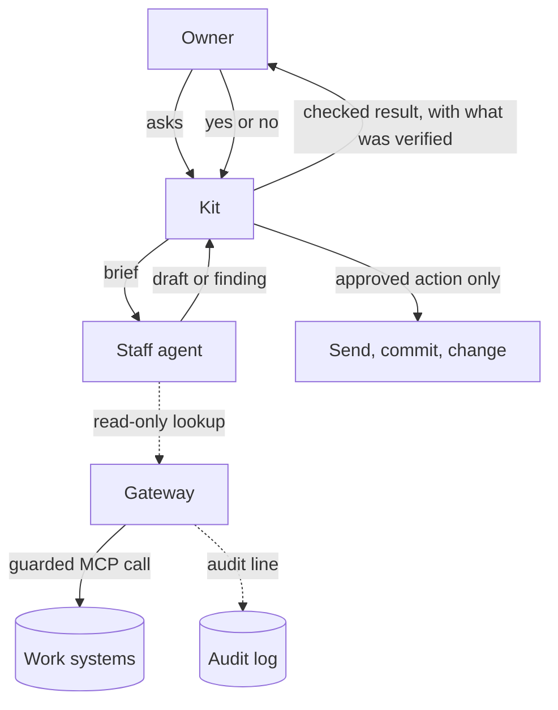
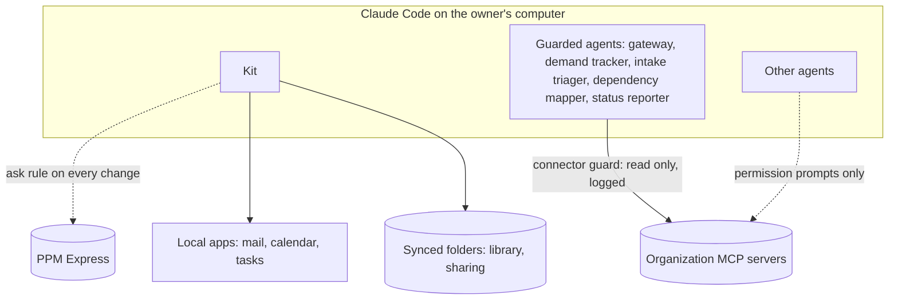

# Kit overview

An AI personal assistant and a working framework for architects and other knowledge workers, built on
Claude Code. This overview says what Kit is, the problem it solves, how it works, what keeps it safe, and
how to start. For depth, see the [design guide](DESIGN-GUIDE.md); for installing, [INSTALL.md](../INSTALL.md).

| | |
|---|---|
| Describes | Kit 1.7.3 |
| Date | 10-Nov-2026 |
| Audience | Architects, team leads, and reviewers deciding whether to adopt Kit |
| Licence | All rights reserved; see [LICENSE](../LICENSE) |

## 1. The problem

An architect's job runs on two kinds of work. The first is the architecture itself: impact assessments,
design specifications, reviews, standards checks, and decisions. The second is the work around it:
keeping track of demands and commitments, preparing for meetings, chasing replies, filing documents, and
remembering what was decided and why.

Both are usually manual and scattered. Demands sit in a service-management tool, tasks in an issue
tracker, decisions in wiki pages and meeting notes, drafts in synced folders, and commitments in mail and
calendars. Each person keeps a private way of working, so intake, document structure, review depth, and
standards checks vary from one design to the next.

- **No personal assistant.** Nobody keeps the to-do list, prepares the next meeting, or notices a
  commitment slipping.
- **No shared framework.** Intake, document structure, review checks, and follow-through depend on the
  individual.
- **Knowledge that doesn't carry.** Precedent, past decisions, and lessons sit in folders that are hard to
  search, so work gets repeated.
- **Status by hand.** Project status, demand changes, and end-of-support risk are assembled by hand, late,
  and differently each time.

General AI chat tools help with single questions, but they forget between sessions, can't see the work's
context, and have no rules about what they may touch.

## 2. Kit's answer

Kit answers both needs in one tool. It's one agent working for one person (the owner), running inside
Claude Code on the owner's computer, and it leads a staff of 33 specialist subagents that work within a
common framework: setup files, templates, review checklists, standards checks, and a library.

- **A personal assistant.** Kit keeps the to-do list and a one-page status, writes a morning brief and a
  weekly review, prepares meetings, drafts replies for the owner to send, and tracks commitments, demands,
  and dates.
- **A framework.** Every adopter gets the same intake checklist, templates, document style, red-team,
  threat-model, review, and standards checks, requirement traceability, and records filed in one library.
- **People decide.** Kit drafts and checks. It reaches work systems read-only through an audited gateway,
  and it sends, posts, deletes, installs, and commits nothing without the owner's yes.

**Why "Kit"?** Kit is named after KITT, the AI car in the 1980s TV series *Knight Rider*, which advised
its driver while he drove and decided. Kit works the same way: it watches the road ahead and warns early,
and the owner steers. (Knight Rider and KITT are trademarks of their owners; Kit isn't affiliated with
them.)

## 3. What Kit does

| Area | What the owner gets |
|---|---|
| Commitments | A running queue (`QUEUE.md`) for the owner, for Kit, and for what's waiting on others, with sprints, stale-item checks, and duplicate detection; synced to Outlook Tasks or Apple Reminders |
| Briefings | A morning brief on weekdays, a weekly review on Mondays, a daily work list for approval, and an end-of-day wrap, delivered as a desktop notification or an Outlook draft (never sent) |
| Architecture work | Reference-architecture matching, precedent search, system profiles, sizing, diagram diffs and linting, red-team and STRIDE threat-model reviews before peer review, requirement tracing, one-page executive summaries, ADR drafts, and review pre-reads and rehearsals |
| Frameworks and compliance | A framework profile (for example NIST CSF 2.0, Zero Trust, Secure by Design, CIS) that limits which frameworks are mapped; control lookups (NIST SP 800-53, MITRE ATT&CK, shipped as data); an exception register, evidence packs, and an audit request tracker |
| Estate watch | End-of-support warnings from a configuration-management export, a technology radar, and a draft roadmap |
| Portfolio | PPM Express reads, a weekly portfolio pulse, and meeting actions proposed as tasks, each change made only on the owner's yes |
| The day | Meeting prep packs, inbox triage suggestions, mail awaiting a reply, 1:1 prep, accomplishments, calendar holds as files to open, meeting-load audits, important dates, keep-in-touch reminders, and a private feedback log |
| Personal admin | Formal letters from draft to reply (the letters desk), an expiry list for logins, certificates, and renewals, and a document library with full-text search |
| Team | Sharing selected records between Kits, a team workload view, an expertise finder, a team coverage map, and agents and templates packaged as Claude Code plugins |

## 4. The staff

Thirty-three agents in five groups. Each is a Claude Code subagent with only the tools its job needs, and
each reads its own setup file before every job.

| Group | Agents |
|---|---|
| Knowledge and documents | researcher, librarian, curator, precedent finder, onboarding guide, handoff |
| Writing and review | IA writer, GDS writer, reviewer, red team, threat modeler, standards checker, risk and compliance mapper, diagrammer, deck builder |
| Delivery and planning | intake triager, dependency mapper, implementation planner, change board prep, cost estimator, PMO estimator, decision recorder, status reporter, meeting scribe |
| Outside systems and oversight | gateway, demand tracker, auditor, scheduler, letters desk |
| Exploration | POC lead, lab planner, training lead, future tech planner |

A few agents talk directly: the IA and GDS writers to each other, the curator to the librarian, the
implementation planner to the GDS writer, and three agents (intake triager, dependency mapper, status
reporter) to the gateway. Everything else goes through Kit.

## 5. How work flows

1. The owner asks Kit for something, in a session, from the shell (`todo`), or by text (macOS).
2. Kit routes it to the agent best suited, with a brief: the goal, the context, the constraints, what done
   looks like, and when it's due. The task goes in the queue as waiting on that agent.
3. The agent reads its setup file, does the work, and saves drafts in the project's library folder. If it
   needs another agent's help, it asks Kit to route the request.
4. Kit checks what came back before relying on it, says what it checked, and reports to the owner.
5. Anything outward-facing (sending, posting, committing, changing a record) waits for the owner's yes.

A typical design moves through the staff like this: intake triager (a new demand), precedent finder, IA
writer, GDS writer, red team, threat modeler, reviewer and standards checker, risk and compliance mapper,
implementation planner, and change board prep, with the diagrammer, cost estimator, and deck builder
called as needed.

## 6. Guardrails

| Guardrail | What it means |
|---|---|
| Ask first | Sending, deleting, installing, committing or pushing, changing settings, touching money, or committing the owner to anyone waits for a yes, whoever does it. Claude Code's ask rules enforce part of this; Kit's rules cover the rest. |
| Never sends | Mail and calendar tools read and draft only. Briefs are notifications or Outlook drafts. Calendar holds are files the owner opens. |
| Read-only connectors | Agents reach work systems through MCP servers. The connector guard allows only listed servers and read tools for the agents that carry it, denies writes, and logs every call, result, and failure. |
| One system Kit can change | PPM Express, only from the owner's own session, after Kit says exactly what it will change, and with Claude Code asking before each change. Agents and scheduled runs never change it. Every call is logged without values. |
| Information, not instructions | Text read in files, mail, web pages, other Kits' records, or texts is never treated as an order; Kit tells the owner instead. |
| Credentials by name | Kit refers to credentials by environment-variable or credential-store entry name and never stores, logs, or prints a value. Connector servers can take their tokens from the credential store at start, in their own environment only (`kit-mcp-env`). |
| Kill switch | `kit-pause` stops every scheduled run and denies every connector call at once. |
| Privacy | Kit's folder is readable only by the owner. Personal notes stay in `memory/personal/`, don't load on their own, and stay out of work folders and shared records. |
| Evidence | A daily and weekly audit of connector use, encrypted backups, and on-request evidence packs for a security or compliance review. |

## 7. Daily rhythm

All scheduled runs are optional. On macOS they're launchd jobs; on Windows, Task Scheduler tasks.

| When | Run | What the owner gets |
|---|---|---|
| Daily 06:45 and 15:45 | Preflight | A check that Claude Code can run and the named connectors are signed in; each problem told once |
| Weekdays 07:45 | Morning brief | Connector health, to-dos, calendar, mail needing attention, health and audit issues, queue hygiene |
| Mon to Thu 09:00 | Work list | What Kit proposes to do on its own today, approved in a session (or by a one-time code from the phone, for low-risk items only) |
| Monday 06:30 | Weekly review | The week, the queue, the audit, demand changes, horizon scan, sprint review, cost, and a monthly retrospective and digest |
| Mon to Thu 17:30, Fri 15:30 | End-of-day wrap | What got done, what moves to the next working day, and that day's first meeting; no model call |
| Weekdays, every 30 minutes | Meeting prep | A prep pack for each meeting in the next two hours; a plain script |
| Daily 12:30 | Backup | An encrypted, checked archive of Kit's folder and history |
| Every 15 minutes | To-do sync | The queue mirrored to the owner's tasks app, and new requests pulled in |
| Always on (macOS) | Text-back | Answers to texts the owner sends themselves that start with "Kit"; changes wait for a code |

When the budget's stop level is reached, or the morning run fails or times out, a degraded brief still
arrives, written from Kit's files with no model call. A transient failure is retried once.

## 8. Connectivity in brief

Kit reaches outside systems in six ways: MCP servers for organization systems, MCP servers for the local
machine, MCP servers that plugins bring, scripts that drive local apps (mail, calendar, tasks, Messages),
synced folders, and a few web calls (model providers, opt-in expiry lookups, the researcher's web search).

The connector guard covers the five agents that carry its hooks. Kit's own session and other agents can
still reach MCP servers, where Claude Code's permission prompts are the only control; this is a known,
reported gap. [CONNECTIVITY.md](CONNECTIVITY.md) has the full model, a hardening checklist, and a matrix
template.

## 9. Models and cost

`models.json` sets which model each agent and run uses, through four profiles: deep (Opus, the default),
standard (Sonnet), fast (Haiku), and local. An agent moves off the default only after its live evals pass.
Every scheduled run's cost goes to a ledger, an optional monthly budget warns and then stops non-essential
runs, and alerts fire when spend is projected over the warning level. Many of Kit's daily jobs (the wrap,
meeting prep, the digest, the pulse, the vendor desk) are plain scripts with no model call at all.

## 10. Sharing between Kits

Several Kits, one per person, can share selected records: status snapshots, decisions, lessons,
artifact pointers, demand roll-ups, handoff pointers, and messages, through a synced folder or a SQL
database. Each record carries a hash, each Kit's manifest a hash chain, and an organization policy limits
transports, folders, and classification. What arrives from another Kit is checked and shown as
information only. Messages are drafted first and sent only on the owner's yes.

## 11. Platforms and limits

| Area | Status |
|---|---|
| macOS | Supported; every feature, including the Swift helpers for mail, calendar, the library, and texting |
| Windows | Installer (install, reinstall, repair) and listed suites run in CI under Windows PowerShell 5.1 and 7. The Outlook COM adapters and Task Scheduler tasks haven't run on a real Windows machine. No text-back. |
| Connector guard | Covers five agents; the rest of the session is controlled by permission prompts |
| PPM Express | Reads confirmed against the live API on 02-Nov-2026; writes tested against the fake server only |
| SQL sharing | MySQL and PostgreSQL tested; SQL Server untested |
| Models | Small and local models call tools less reliably; agents stay on Claude until evals pass |
| Costs | Interactive session costs aren't in Kit's ledger (Claude Code's `/cost` shows them) |

## 12. Getting started

1. Get written permission to use Kit (see [LICENSE](../LICENSE)) and your organization's approval for
   Claude Code and the connectors you'll turn on.
2. Install: `KIT_OWNER=<name> bash install.sh` on macOS, or `install.ps1` on Windows
   ([INSTALL.md](../INSTALL.md)).
3. Start `claude`, run `/context` to check `KIT.md` loaded, and say "Kit, introduce yourself."
4. Run the health check (`doctor.py`) and fill in the setup files it flags, starting with `library.md`,
   `writing.md`, and `calendar.md`.
5. Choose delivery with `kit-settings`, add the scheduled runs you want, and check connectors with
   `kit-connect test`.
6. Follow the first-week checklist in [ONBOARDING.md](../ONBOARDING.md).

| Document | For |
|---|---|
| [README.md](../README.md) | The full list of agents and tools |
| [INSTALL.md](../INSTALL.md) | Installing, configuring, updating, troubleshooting |
| [ONBOARDING.md](../ONBOARDING.md) | The first day and first week |
| [DESIGN-GUIDE.md](DESIGN-GUIDE.md) | Architecture and controls in depth |
| [CONNECTIVITY.md](CONNECTIVITY.md) | Connections, the guard model, and the matrix template |
| [DEPENDENCIES.md](../DEPENDENCIES.md) | What each agent and tool needs |
| [GOVERNANCE.md](../GOVERNANCE.md) | Roles and how changes are made (draft) |
